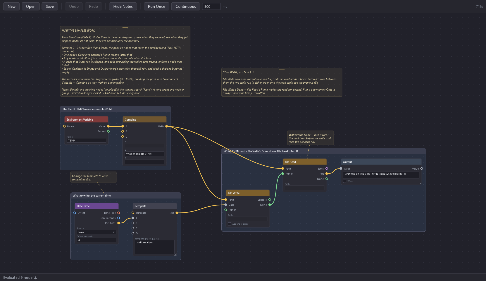
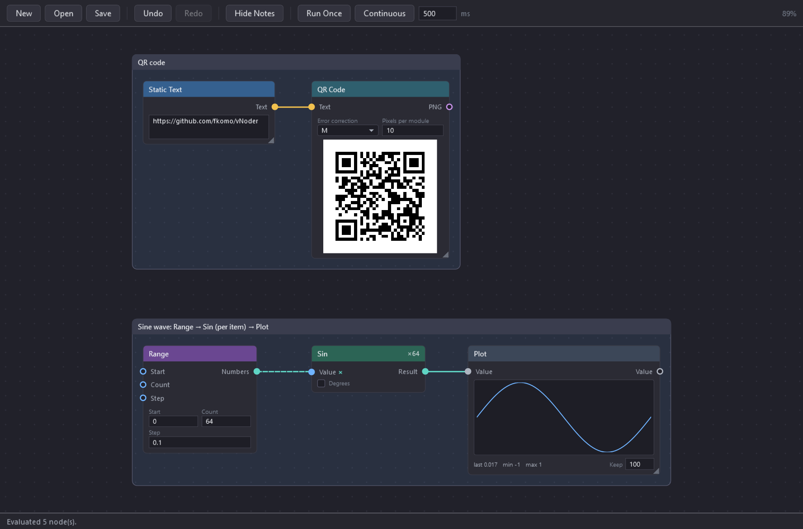
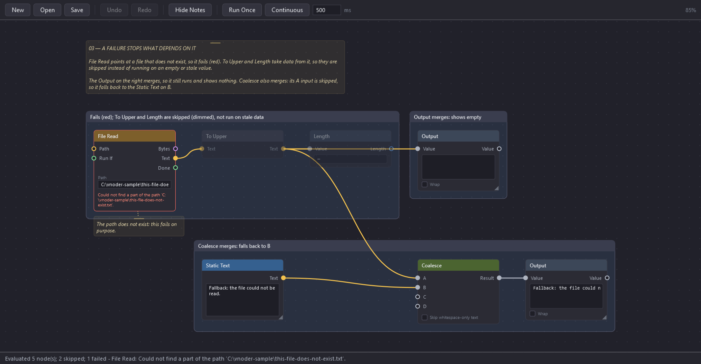
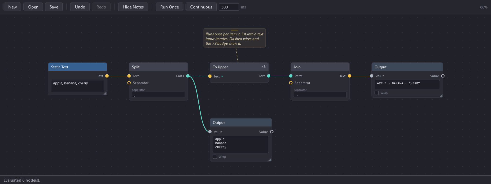

# vNoder

A node-based visual scripting editor for Windows, in the spirit of Unreal Blueprints or Shader Graph.
Drop nodes on a canvas, wire them together through typed ports, edit their values in place, and run
the graph once or continuously.



## Requirements

- Windows (the UI is WPF)
- [.NET 10 SDK](https://dotnet.microsoft.com/download)

## Build and run

The solution lives in `src/` and uses the newer XML solution format, so pass the path explicitly:

```bash
dotnet run --project src/vNoder.App
```

```bash
dotnet build src/vNoder.slnx
```

### From the command line

`vnoder-cli` runs a saved graph once, as Run Once does in the editor, and exits:

```bash
dotnet run --project src/vNoder.Cli -- samples/11-command-line.vnoder --name Ada
```

A graph takes parameters through **CLI Param** nodes, each with a name, a default, a description and
a Required flag. They are given as `--name value` or `--name=value` (a name with no value means
`true`). Put `--help` after the file to list a graph's parameters without running it. An unknown
or missing required parameter stops the run with exit code 2 and the list.

The graph writes to standard output with **CLI Write** and chooses the exit code with **Exit Code**.
Without an Exit Code node the code is 0, or 1 if a node failed; 2 means the file could not be read
or the parameters were wrong,
and 130 that the run was cancelled (Ctrl+C). Load warnings and failed nodes are reported on standard
error, so they never mix with the graph's own output. The clipboard and notification nodes need the
editor and fail under `vnoder-cli`.

## Using it

Double-click empty canvas to open the node catalogue, type to filter, press Enter to place. Drag from
an output port to an input port to wire them up — incompatible ports are refused, and so are
connections that would form a cycle. Drop a wire on empty canvas and the catalogue opens filtered to
nodes that can accept it, with Output at the top, then wires the one you pick automatically.

Press **Run Once** (`Ctrl+R`) to evaluate the graph. Each node flashes as it finishes, in the order
the graph evaluated it — green, or red if it failed — and a node that takes a while, such as an HTTP
request, is outlined in amber while it runs. **Continuous** (`Ctrl+Shift+R`) re-runs it on a timer
(the interval is the box beside the button), without the flashes. While a continuous run is going the button turns red and the status bar
counts iterations and elapsed time.

### Controls

| | |
|---|---|
| Add a node | Double-click empty canvas |
| Pan | Right- or middle-drag empty canvas |
| Zoom | Mouse wheel over empty canvas (zooms about the cursor) |
| Select | Click, Ctrl+click to toggle, or drag a box on empty canvas |
| Move | Drag a node header — moves the whole selection |
| Resize | Drag the corner grip (on nodes that have one) |
| Disconnect | Click a connected input port |
| Run per item / whole list | Right-click a wired input, **For each item of …** |
| Delete | `Delete` |
| Group selection | `G`, or right-click a node |
| Collapse a group | Double-click its header |
| Add a note to a node or group | Right-click it (a group by its header), **Add note** |
| Add a free-standing note | Add a **Note** node (double-click the canvas, search "note") |
| Move / resize / delete a note | Drag its top strip / its corner grip / right-click it |
| Hide or show all notes | `N`, or the toolbar button |
| Copy / paste | `Ctrl+C` / `Ctrl+V` |
| Undo / redo | `Ctrl+Z` / `Ctrl+Y` (or `Ctrl+Shift+Z`), or the toolbar buttons |
| Run once | `Ctrl+R` |
| Run continuously | `Ctrl+Shift+R` |
| New / open / save | `Ctrl+N` / `Ctrl+O` / `Ctrl+S`, `Ctrl+Shift+S` to save as |
| Import another file into this graph | `Ctrl+I`, or **Import** on the toolbar: its nodes, wiring, groups and notes are added, centred in the view and selected, ready to drag into place |

Everything that is saved can be undone: adding, deleting, wiring, moving, resizing, grouping, pasting,
inline values and the run interval. A drag is one step however far it goes, and typing into a node
becomes one step once you pause or move focus. While a text box has focus, `Ctrl+Z` undoes its typing
first. Undoing back to the last save clears the unsaved-changes marker.

Groups are a purely visual convenience: a named box you can drag, collapse and rename. Wires crossing
a collapsed group stay drawn, stubbed to its edge, so you can still see it is connected.

Notes are free text on the canvas, drawn as a faint amber box. A linked note is attached to a node or a
group by a dotted leader line: it moves with it, goes when it is deleted, and is copied and pasted along
with its node. A **Note** node is linked to nothing, and otherwise behaves like any node (select, move,
group, copy). Both can be resized from their corner. `N` hides every note at once (and shows them
again); that is a view setting, not an edit, so it is not saved. A note on a node inside a collapsed
group is hidden with the node.

## Nodes

Nodes show what they make, in place: an image, a table, a plot.



| Category | Nodes |
|---|---|
| Input | Static Number, Static Text |
| Generators | Random Number, Random String, Random Bytes, Random Boolean, Random Gaussian, Range (a list of numbers), GUID (v4 / v7), Name-Based GUID (v5 / v3), Date Time |
| Flow | Changed, Counter, Previous Value, History, Delay (sleep) |
| Text | Substring, Replace All, Split, Join, Concat, Count Occurrences, To Upper, To Lower, Case Convert (camel, Pascal, snake, kebab, constant, title, sentence, slug), Normalize (accents, whitespace, Unicode forms), Lines, Trim, Pad, Reverse, Word Count, Contains (starts / ends with, equals, regex), Template, Regex Match, Regex Replace, Regex Extract All, Diff, Similarity (Levenshtein), Markdown To HTML |
| List | Count, Item At, Index Of, First, Last, Sort (text, natural, numeric), Distinct, Reverse, Shuffle, Random Pick, Filter, Slice, Append, Zip, Chunk, Flatten |
| Convert | To Number, To Text, To Boolean, Number Format (decimals, grouping, percent, file size, custom), Base Convert (binary, octal, hex, any base 2–36) |
| JSON | Get (by path, e.g. `data.items[0].name`), Set, Keys, Merge, From List, Format (indent / minify / validate) |
| Data | CSV Parse, CSV Format, CSV To JSON, JSON To CSV, XML Get (XPath), YAML To JSON, JSON To YAML |
| Date | Parse, Format, Add, Difference, Date Parts (weekday, ISO week …), Start End Of (day, week, month, quarter, year), Time Zone Convert, Cron Next, To Unix, From Unix |
| Math | Expression (a formula typed as text in x, y, z, w — `sqrt(x^2 + y^2)`, `2x + 1`, `if(x < 0, -x, x)`; hover its formula box for the syntax), Add, Subtract, Multiply, Divide, Modulo, Power, Min, Max, Abs, Negate, Sign, Floor, Ceiling, Round, Clamp, Sqrt, Exp, Ln, Log10, Log (any base), Sin, Cos, Tan, Asin, Acos, Atan, Atan2, Constant (π, τ, e), Aggregate (sum, average, min, max, product, median, std dev of a list), Map Range, Lerp, Bitwise |
| Logic | And, Or, Xor, Nand, Not, Boolean, Equals, Compare, Select (if / else), Is Empty, Coalesce, Type Of |
| Encoding | Base64 Encode / Decode, Base32 Encode / Decode, URL Encode / Decode, Hex Encode / Decode, HTML Escape / Unescape, Text To Bytes / Bytes To Text (UTF-16, Latin-1, Windows code pages), Compress / Decompress (GZip, Deflate, ZLib, Brotli), JWT Encode / Decode, QR Code, Barcode Read (QR, EAN, UPC, Code 128, Data Matrix, PDF 417 …) |
| Crypto | Hash (MD5, SHA-1, SHA-256, SHA-384, SHA-512, CRC32), HMAC, AES Encrypt / Decrypt, BCrypt Hash, BCrypt Verify, PBKDF2, TOTP (2FA codes), Key Pair, Sign Data, Verify Signature, Self-Signed Certificate (or a CA), Issue Certificate (signed by your CA), Certificate Request (CSR), Certificate Load (PFX, P12, CRT, CER, PEM) |
| IO | File Read, File Write, File Copy, File Move, File Hash (streamed), Path Delete (files and directories), Path Exists, File Info, Create Directory, File Search, Directory Size, Drive Info, Zip Create, Zip Extract, Image Load, Image Save |
| Path | Path Parts, Combine, Change Extension, Special Folder (Temp, Desktop, Downloads, AppData …) |
| System | Environment Variable, Run Process, Process List, Process Kill, Machine Info, Registry Read, Clipboard Get / Set, Notify (desktop notification) |
| CLI | CLI Param (a named `--name value` argument, optional or required), CLI Write (to standard output or error), Exit Code (for `vnoder-cli`) |
| Network | HTTP Request (GET, POST, PUT, PATCH, DELETE; a raw body, or form fields URL-encoded for HTML forms and OAuth2 token endpoints), Download To File, URL Parse, URL Build, TLS Certificate (a server's certificate and expiry), DNS Lookup, Ping, TCP Port Check, IP Range (CIDR), Send Email (SMTP) |
| Image | Convert (to PNG, JPEG, WebP, GIF, BMP, TIFF, TGA, QOI, PBM), Resize (fit, fill, stretch, pad; thumbnails), Crop, Rotate Flip (and EXIF auto-orient), Adjust (brightness, contrast, saturation, hue), Filter (grayscale, sepia, invert, blur, sharpen, pixelate), Draw Text (watermarks, captions), Solid Color, To Data URI |
| Output | Output, Note (free text, linked to nothing), Length, Image (PNG, JPEG, GIF, BMP, TIFF, ICO, WebP, TGA, QOI, PBM, or Base64 text), Table, Plot (a value over time), Log (a timestamped trail) |

Ports carry one of `number`, `text`, `boolean`, `bytes`, `date/time`, `any`, or a list of those (`text
list`, `number list` …), and wire
colour follows the type (every kind of list is teal). Most node parameters can be either typed in place or driven by a wire — connect one
and the inline field greys out.

Evaluation order comes from the wiring: nodes are sorted by data dependency, and a node with no path
between it and another has no guaranteed order relative to it. A node that fails is reported on the
node itself; the rest of the pass carries on, but the nodes that take data from it are skipped rather
than run on an empty or stale value.

### Run If and Done

Nodes that touch the outside world — the file, folder and zip nodes, Image Load and Save, the network
nodes, the process nodes, the clipboard and Notify — have a **Run If** input and a **Done** output:

- Left unwired, Run If changes nothing: the node runs on every pass.
- Wired, the node runs only when the value is true. Since the wire also orders the two nodes, wiring
  one node's **Done** into another's **Run If** means "after that": File Write → Done → Run If → File
  Read reads what was just written. Any boolean works as a condition, such as Compare or Is Empty.
- Done is true once the node has run without error. It is not the same as the node's own Success: a
  File Copy that skipped an existing file still ran.

A node that is not run is **skipped**: drawn dimmed (and without a flash during Run Once), and its
outputs empty. Everything that takes data from a skipped or failed node is skipped as well, so gating
the first node of a branch stops the whole branch. Select, Coalesce, Is Empty and Output are the
exception: they bring branches together, so they still run and read the skipped side as empty. That is
how to build an if / else: gate each branch, and join them with Select or Coalesce.



Dropping a Done wire on empty canvas connects the new node's Run If.

### Doing something per item

Wiring a list into an input that takes a single value runs the node **once per item**. Its outputs become
lists, one entry per item, and nodes further down follow on their own for as long as they take single
values. Lines → To Upper upper-cases each line; File Search → File Read → Hash hashes every file found.



- A per-item wire is **dashed**, its input carries a teal **×**, and the node's header shows **×N**, the
  number of items in the last run.
- An input that would also take the whole list — an `any` input like Hash's Data or Output's Value —
  takes it whole until you say otherwise: right-click it and tick **For each item of …**. Unticking goes
  back to the whole list, where the input's type allows it.
- Inputs that are not per item get the same value every time: Template with a list on A and a fixed
  template fills it once per item.
- Two per-item inputs on one node are **paired by position**: a list of names on A and a list of emails
  on B gives name 1 with email 1, and so on. Lists of different lengths fail the node rather than guess.
- If any item fails, the whole node fails, with the item's number in the message.
- A per-item node whose output is already a list (Split per line) gives a **list of lists**; Join on it
  runs per item again, joining each inner list. Output shows an inner list as `[a, b, c]`.
- Run If always gates the node as a whole, never per item, and Done is a single true once every item
  has run. The graphs in [`samples/`](samples/) show each of these in action.

Nodes with side effects — File Write, File Copy, File Move, Path Delete, Create Directory, Image Save,
Zip Create and Extract, HTTP Request, Download To File, Send Email, Run Process, Process Kill,
Clipboard Set and Notify — act on every pass, so in a continuous run they fire on every tick; see
**Reacting to change** below for firing only when something happens. An
HTTP error status (404, 500) is a result, reported on the node's Status and Success outputs along with
the body, not a failure. The same goes for a value that does not parse (To Number, Parse, JSON Get on a
missing path): the node reports it on a Success or Found output rather than failing, so it can drive a
Select.

JSON travels as text, so HTTP Request and File Read wire straight into JSON Get, and a JSON array comes
out as a text list for the List nodes. Run Process is killed, with anything it started, when its timeout
passes or a continuous run is stopped.

Inline values are saved in the graph file, including secrets typed into a node: the HMAC key, the AES,
PFX, CA and key passwords, the JWT and TOTP secrets and the SMTP password. Their fields say so. To keep
a secret out of the file, wire it in instead, from Environment Variable for example.

### Reacting to change

A continuous run evaluates the whole graph every tick. The **Flow** nodes remember earlier passes, which
is what lets a graph act when something *changes* rather than every time it looks:

- **Changed** is true when its value differs from the last pass. Wired into Run If, it turns "every
  tick" into "when it happens": File Info's Modified → Changed → Run If of Notify, or HTTP Request's
  Body → Changed → Send Email.
- **Counter** counts passes (or the passes where Count If is true), **Previous Value** gives the value
  from the pass before, and **History** keeps the last N values as a list, for Aggregate or Plot.
- **Plot** and **Log** in Output keep a history the same way: a value over time, and a timestamped line
  per value, newest first.
- **Delay** waits before passing its value on, for spacing side effects apart.

Their memory starts over whenever a continuous run starts, and carries on between presses of Run Once,
so a graph can be stepped through by hand. It is never saved in the file.

## Files

Graphs save as JSON with a `.vnoder` extension, holding the nodes and their inline values, the wiring,
any groups and notes, and the current zoom and pan. Node types are stored by name (`"type": "Math/Add"`), so the
file stays readable. A file that references something this build does not have still opens — the parts
that could not be restored are reported and the rest loads.

File Write, File Copy, File Move and Image Save create any missing folders in the path. The
destination of File Copy and File Move may be a file path or an existing folder to put the file in, and
like Image Save they can overwrite, skip or number an existing file. Path Delete removes a file or an
empty directory; a directory with contents is deleted only with Recursive ticked, links (junctions,
symbolic links) are removed without touching what they point at, and a drive root is always refused.

Image Save writes in the format its file extension names, converting when the image is in a
different one (a PNG saved as `photo.jpg` becomes a JPEG); leave the extension off to keep the format.
Converting a transparent image to JPEG, BMP or PBM, which have no transparency, puts it on white.
Resize, Crop and Rotate Flip keep the image's format (and a JPEG's quality); follow them with Convert
to change it.

## Project layout

- `src/vNoder.Core` — graph model, port types, node registry, execution engine. No UI dependency.
- `src/vNoder.Nodes` — the node implementations.
- `src/vNoder.App` — the WPF application.
- `src/vNoder.Cli` — `vnoder-cli`, the command-line runner.

The nodes use these libraries:

| Library | For | License |
|---|---|---|
| [ImageSharp](https://github.com/SixLabors/ImageSharp) and ImageSharp.Drawing | image conversion, editing and Draw Text | Six Labors Split License |
| [BCrypt.Net-Next](https://github.com/BcryptNet/bcrypt.net) | BCrypt Hash and Verify | MIT |
| [QRCoder](https://github.com/codebude/QRCoder) | QR Code | MIT |
| [ZXing.Net](https://github.com/micjahn/ZXing.Net) | Barcode Read | Apache 2.0 |
| [Cronos](https://github.com/HangfireIO/Cronos) | Cron Next | MIT |
| [MailKit](https://github.com/jstedfast/MailKit) | Send Email | MIT |
| [Markdig](https://github.com/xoofx/markdig) | Markdown To HTML | BSD 2-Clause |
| [YamlDotNet](https://github.com/aaubry/YamlDotNet) | YAML To JSON, JSON To YAML | MIT |

The Six Labors Split License is Apache 2.0 for open-source use, for-profits under 1M USD annual revenue
and non-profits, and a commercial license otherwise. ImageSharp is pinned to 3.1 and ImageSharp.Drawing
to 2.1, the line built on it (see `src/Directory.Packages.props`).

Adding a node type is one class with one attribute; the registry finds it by reflection and it
appears in the catalogue, with its editable properties saved and loaded automatically. See
[CLAUDE.md](CLAUDE.md) for the conventions that go with that.

## Status

A working proof of concept. The canvas is virtualized: only nodes near the viewport have visuals, and
wires are drawn as lightweight visuals culled to the viewport, so graphs in the thousands of nodes
open in a fraction of a second and stay responsive to pan and zoom.
